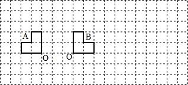

# Mathematics (Grade 3)

**ID**: dd12ae17
**难度**: medium_hard
**题型**: multiple_choice

## 题目
将图形 A（  ），可以得到图形B．

$\begin{description}
\item A．向右平移3格，再绕O点逆时针旋择90°\item B．向右平移5格，再绕O点顺时针旋择90°\item C．向右平移3格，再绕O点顺时针旋择90°
\end{description}$

## 解答

**答案**: C

1. Step1:观察图形A和图形B的位置关系
2. Step2:判断图形A需要先进行平移操作，发现向右平移3格可使图形A在水平位置上更接近图形B
3. Step3:在平移后，判断还需进行旋转操作，确定绕O点顺时针旋转90°可使图形A与图形B重合
4. Step4:根据上述分析，从选项中找出符合的选项C

## 知识点

**知识点**:
  - 作平移后的图形；将简单图形平移或旋转一定的度数．

---
