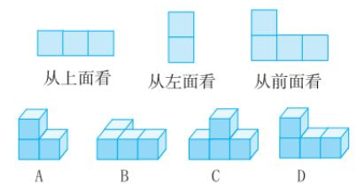

# Mathematics (Grade 3)

**ID**: e7d00560
**难度**: medium_hard
**题型**: multiple_choice

## 题目
下图是从三个不同方向观察到的小正方体摆成的物体的情形，（）的摆法符合要求。

## 解答

**答案**: D

1. Step1:根据从上面看到的图形，判断该几何体有1行，3列，排除A和B选项
2. Step2:依据从左面看到的图形，发现C和D选项都符合
3. Step3:按照从前面看到的图形，确定该几何体有2层且第二层的小正方体在最左边，排除C选项，得出只有D选项满足

## 知识点

**知识点**:
  - 从不同方向观察物体

---
