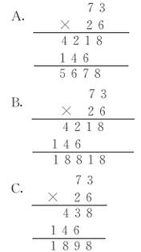

# Mathematics (Grade 3)

**ID**: e906cf91
**难度**: medium_hard
**题型**: multiple_choice

## 题目
下列竖式中，计算73×26正确的是（）。

## 解答

**答案**: C

1. Step1:明确整数乘法计算法则为先用一个因数每一位上的数分别去乘另一个因数各个数位上的数，用因数哪一位上的数去乘，乘得的数的末尾就对齐哪一位，然后把各次乘得的数加起来
2. Step2:分析选项A，两个因数的个位相乘3×6=18，积的个写8进1，这个1应加进6和7相乘的得数中去，即6×7+1=43，而题目中的竖式直接将进的1写在了积的十位上，导致计算结果错误
3. Step3:分析选项B，其错误原因同选项A
4. Step4:分析选项C，根据整数乘法的计算法则，可知其计算正确
5. Step5:综上，正确答案是C

## 知识点

**知识点**:
  - 多位数的乘法

---
