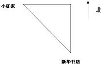

# Mathematics (Grade 3)

**ID**: ecb1a36b
**难度**: medium_hard
**题型**: multiple_choice

## 题目
如图，新华书店在小红家的（  ）

$\begin{description}
\item A．西南方向\item B．东南方向\item C．东北方向
\end{description}$

## 解答

**答案**: B

1. Step1:明确观测点为小红家
2. Step2:依据上北下南，左西右东的基本方位辨别法
3. Step3:结合图中信息判断新华书店位置
4. Step4:得出新华书店在小红家东南方向，所以答案选B

## 知识点

**知识点**:
  - 方向．

---
