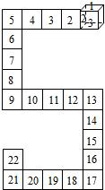

# Mathematics (Grade 3)

**ID**: ecfcfa61
**难度**: medium_hard
**题型**: multiple_choice

## 题目
有一个正方体木块，木块六个面上分别写着数字1、2、3、4、5、6．其中，1与4，2与5，3与6相对．现在把这个木块放在如图第一格内（看得见的三个面上的数字如图所示，其中朝上的面上写着数字1）．如果将木块沿着图中的方格滚动（每次滚动一小格），当木块滚到第22个格时，木块朝上的面上写着的数字是(    )．

## 解答

**答案**: 3

1. Step1:分析木块滚动规律，发现1朝上时，向任意方向每移动4次就会回到数字1朝上的状态
2. Step2:计算从第1格到第21格移动的步数，21 - 1 = 20步
3. Step3:用移动步数除以4，即20÷4 = 5，没有余数，可知第21格时数字1朝上
4. Step4:从第21格到第22格再向上移动1格，根据相对面关系得出此时朝上数字为3

## 知识点

**知识点**:
  - 简单周期现象中的规律．

---
