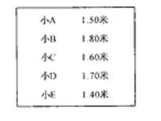

# Mathematics (Grade 3)

**ID**: ed74b941
**难度**: medium_hard
**题型**: multiple_choice

## 题目
下面是一组同学的跳远成绩，他们的平均成绩是1.60米。增加哪两个人不会改变平均成绩。(   )

A．小F(1.60米)和小G(1.75米)
B．小F(1.60米)和小H(1.50米)
C．小T(1.45米)和小H(1.50米)
D．小T(1.45米)和小G(1.75米)

## 解答

**答案**: D

1. Step1:已知原来同学的平均成绩是1.60米，要使增加两个人后平均成绩不变，则增加两人的平均成绩也应为1.60米。
2. Step2:计算选项A中两人的平均成绩，(1.60 + 1.75)÷2 = 1.675米，不符合要求。
3. Step3:计算选项B中两人的平均成绩，(1.60 + 1.50)÷2 = 1.55米，不符合要求。
4. Step4:计算选项C中两人的平均成绩，(1.45 + 1.50)÷2 = 1.475米，不符合要求。
5. Step5:计算选项D中两人的平均成绩，(1.45 + 1.75)÷2 = 1.60米，符合要求。

## 知识点

**知识点**:
  - 小学数学;统计和概率;统计;平均数、中位数、众数;平均数的意义及求法

---
