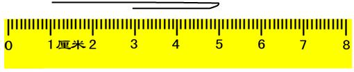

# Mathematics (Grade 3)

**ID**: f3015b52
**难度**: medium_hard
**题型**: multiple_choice

## 题目
如果将如图中的绳子拉直，它的长度大约为（  ）厘米．

$\begin{description}
\item A．4\item B．5\item C．6\item D．8
\end{description}$

## 解答

**答案**: C

1. Step1:确定绳子第一段的长度范围为1厘米到5厘米
2. Step2:计算绳子第一段的长度，用5 - 1 = 4厘米
3. Step3:确定绳子第二段的长度范围为3厘米到5厘米
4. Step4:计算绳子第二段的长度，用5 - 3 = 2厘米
5. Step5:将两段绳子的长度相加，4 + 2 = 6厘米
6. Step6:得出绳子拉直后的长度大约为6厘米，所以选C

## 知识点

**知识点**:
  - 长度的测量方法．

---
