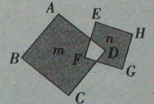

# Mathematics (Grade 3)

**ID**: f3112903
**难度**: medium_hard
**题型**: multiple_choice

## 题目
如图，正方形ABCD的面积为2014，正方形EFGH的面积为2013，两阴影部分的面积分为为m、n（m>n），则
 $\sqrt[3]{m−n}=（\,\,\,\,）$
 A.1
 B.4
 C.-1
 D.-4

## 解答

**答案**: A

1. Step1:设两正方形重叠部分的面积为s
2. Step2:根据正方形ABCD面积为2014，可得s + m = 2014
3. Step3:根据正方形EFGH面积为2013，可得s + n = 2013
4. Step4:用(s + m) - (s + n)，即m - n = 2014 - 2013 = 1
5. Step5:计算$\sqrt[3]{m - n}$的值，因为m - n = 1，所以$\sqrt[3]{m - n}=\sqrt[3]{1}=1$
## 知识点

**知识点**:
  - --

---
