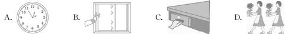

# Mathematics (Grade 3)

**ID**: f5ddabbf
**难度**: medium_hard
**题型**: multiple_choice

## 题目
下列属于旋转现象的是（）

## 解答

**答案**: A

1. Step1:明确旋转的定义为在平面内，将一个图形绕一点按某个方向转动一个角度，这样的运动叫做图形的旋转。
2. Step2:分析选项A，钟面上的指针是绕着钟面中心按某个方向转动，符合旋转的定义。
3. Step3:分析选项B，窗户的运动是沿着一个方向做直线运动，属于平移现象，不符合旋转定义。
4. Step4:分析选项C，抽屉的运动是沿着轨道做直线运动，属于平移现象，不符合旋转定义。
5. Step5:分析选项D，人向前走是沿着直线做直线运动，属于平移现象，不符合旋转定义。
6. Step6:综上，只有选项A属于旋转现象，所以答案是A。

## 知识点

**知识点**:
  - 旋转

---
