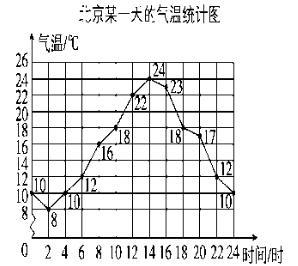

# Mathematics (Grade 3)

**ID**: f9272a4e
**难度**: medium_hard
**题型**: multiple_choice

## 题目
下图是北京某一天的气温，下列说法中错误的是(   )

$\begin{description}
\item A．这一天的最高气温是24℃\item B．这一天最高气温与最低气温的差是16℃\item C．这一天中只有14时至24时之间的气温在逐渐降低\item D．这一天中8时至24时之间的气温在逐渐升高
\end{description}$

## 解答

**答案**: C

1. Step1:观察气温统计图，找到最高点对应的气温值为24℃，所以这一天的最高气温是24℃，A选项说法正确
2. Step2:从统计图中可知最低气温是8℃，最高气温是24℃，计算它们的差值为24 - 8 = 16℃，所以这一天最高气温与最低气温的差是16℃，B选项说法正确
3. Step3:观察统计图发现，14时至16时气温不变，16时至24时气温在逐渐降低，并非只有14时至24时之间的气温在逐渐降低，C选项说法错误
4. Step4:观察统计图可知，8时至14时气温在逐渐升高，14时至16时气温不变，16时至24时气温降低，并非8时至24时之间的气温在逐渐升高，D选项说法错误

## 知识点

**知识点**:
  - 小学数学;统计和概率;统计;统计图表的综合应用

---
