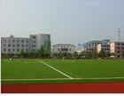

# Mathematics (Grade 3)

**ID**: fb8cdfa1
**难度**: medium_hard
**题型**: multiple_choice

## 题目
估计一下你们学校的操场占地约是2（  ）
$\begin{description}
\item A．平方米\item B．公顷\item C．平方千米
\end{description}$

## 解答

**答案**: B

1. Step1:明确题目是要对学校操场占地面积选择合适的面积单位
2. Step2:根据生活经验、对面积单位和数据大小的认识进行判断
3. Step3:分析选项A，平方米通常用于较小的面积，学校操场面积较大，不符合
4. Step4:分析选项B，公顷是较大的面积单位，符合学校操场的面积规模
5. Step5:分析选项C，平方千米是非常大的面积单位，一般用于城市、国家等大面积，对于学校操场过大，不符合
6. Step6:得出结论，学校操场占地约是2公顷，答案选B

## 知识点

**知识点**:
  - 根据情景选择合适的计量单位．

---
