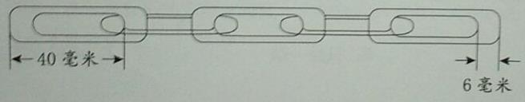

# Mathematics (Grade 3)

**ID**: 01bf3caa
**难度**: medium_hard
**题型**: short_answer

## 题目
下图是5个大小相同的铁环连在一起的图形，它的长度是多少毫米？（提示：5个连在一起的铁环长度可看作3个完整的铁环与2个去掉两端接头部分的铁环的长度之和）

## 解答

**答案**: 206

1. Step1:计算一个完整铁环的长度，为40+6=46毫米
2. Step2:计算去掉两端接头部分的铁环长度，为40-6=34毫米
3. Step3:根据提示，计算5个连在一起铁环的长度，为46×3+34×2=138+68=206毫米

## 知识点

**知识点**:
  - --

---
