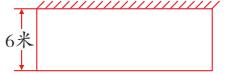

# Mathematics (Grade 3)

**ID**: 02671866
**难度**: medium_hard
**题型**: short_answer

## 题目
如图靠墙边围成一个长方形的花坛，这个长方形花坛的宽是6米，围花坛的篱笆长46米，求这个花坛的面积？

## 解答

**答案**: 204

1. Step1:根据题意可知一边靠墙，篱笆长等于2个宽的长度加上一个长的长度，所以先计算长，长为46 - 6×2 = 34米
2. Step2:已知长方形面积=长×宽，长为34米，宽为6米，所以面积为34×6 = 204平方米

## 知识点

**知识点**:
  - 长方形与正方形的周长;长方形与正方形的面积

---
