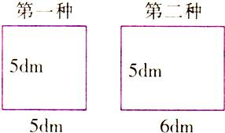

# Mathematics (Grade 3)

**ID**: 056d17cb
**难度**: medium_hard
**题型**: short_answer

## 题目
王叔叔家的一个客厅要铺地砖．
①如果用第一种地砖铺客厅需120块．这个客厅的面积是多少？
②如果用第二种地砖，铺这个客厅需多少块？
③第二种地砖每块16元，铺这个客厅的地砖至少需要多少元？

## 解答

**答案**: 3000, 100, 1600

1. Step1:计算第一种地砖（边长为5分米的正方形）的面积，根据正方形面积公式：面积 = 边长×边长，可得5×5 = 25（平方分米）
2. Step2:已知用第一种地砖铺客厅需120块，根据客厅面积 = 一块第一种地砖面积×第一种地砖块数，可得25×120 = 3000（平方分米），此为客厅面积
3. Step3:计算第二种地砖（长6分米、宽5分米的长方形）的面积，根据长方形面积公式：面积 = 长×宽，可得5×6 = 30（平方分米）
4. Step4:根据第二种地砖块数 = 客厅面积÷一块第二种地砖面积，可得3000÷30 = 100（块）
5. Step5:已知第二种地砖每块16元，根据总价 = 第二种地砖块数×第二种地砖单价，可得16×100 = 1600（元）

## 知识点

**知识点**:
  - 长方形、正方形的面积．

---
