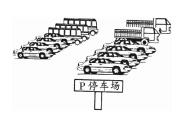

# Mathematics (Grade 3)

**ID**: 1120572d
**难度**: medium_hard
**题型**: short_answer

## 题目
停车场上原来有58辆车。开走了25辆公交车，又开来了10辆大卡车，停车场现有多少辆车？

## 解答

**答案**: 43

1. Step1:明确停车场原来有58辆车
2. Step2:根据开走用减法，计算开走25辆公交车后剩下的车辆数，即58 - 25 = 33辆
3. Step3:根据开来用加法，计算开来10辆大卡车后现有的车辆数，即33 + 10 = 43辆

## 知识点

**知识点**:
  - 整数的加法和减法;整数复合应用题

---
