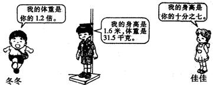

# Mathematics (Grade 3)

**ID**: 16b26b9a
**难度**: medium_hard
**题型**: short_answer

## 题目

①冬冬的体重是多少千克？
②佳佳的身高是多少米？

## 解答

**答案**: 37.8, 1.12

1. Step1:根据已知条件，中间小孩体重是31.5千克，冬冬体重是中间小孩的1.2倍，所以计算冬冬体重为31.5×1.2=37.8千克
2. Step2:根据已知条件，中间小孩身高是1.6米，佳佳身高是中间小孩的十分之七，即0.7倍，所以计算佳佳身高为1.6×0.7=1.12米

## 知识点

**知识点**:
  - 整数、小数复合应用题

---
