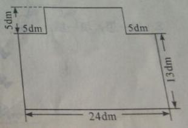

# Mathematics (Grade 3)

**ID**: 16f38a27
**难度**: medium_hard
**题型**: short_answer

## 题目
街心公园有一花坛，如下图所示，它的周长是多少分米？占地面积是多少平方分米？

 5dm 5dm 5dm 13dm 24dm

## 解答

**答案**: 84, 382

1. Step1:分析花坛周长，通过平移可将其转化为一个长24分米，宽为13 + 5 = 18分米的长方形的周长，根据长方形周长公式C=(a + b)×2（其中a为长，b为宽），可得周长为(24 + 18)×2 = 84分米
2. Step2:计算花坛占地面积，先求出长24分米，宽18分米的长方形的总面积为24×18 = 432平方分米
3. Step3:计算左右两个角上小正方形的面积，每个小正方形边长为5分米，根据正方形面积公式S = a²（其中a为边长），一个小正方形面积为5×5 = 25平方分米，两个小正方形面积为25×2 = 50平方分米
4. Step4:用长方形总面积减去两个小正方形面积得到花坛占地面积，即432 - 50 = 382平方分米

## 知识点

**知识点**:
  - 

---
