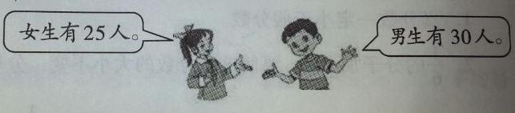

# Mathematics (Grade 3)

**ID**: 19d3a719
**难度**: medium_hard
**题型**: short_answer

## 题目
五（1）班女生人数是男生人数的几分之几？男生人数占全班人数的几分之几？ （结果用最简分数表示）

  25  30

## 解答

**答案**: $\\frac{5}{6}$, $\\frac{6}{11}$

1. Step1:明确求女生人数是男生人数的几分之几，根据解析2，用女生人数除以男生人数，即25÷30，计算得出25÷30 = 5/6
2. Step2:明确求男生人数占全班人数的几分之几，先算出全班人数为25 + 30 = 55人，再根据解析2，用男生人数除以全班人数，即30÷55，计算得出30÷55 = 6/11

## 知识点

**知识点**:
  - 

---
