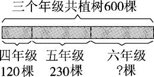

# Mathematics (Grade 3)

**ID**: 1a060a37
**难度**: medium_hard
**题型**: short_answer

## 题目
看图回答。

## 解答

**答案**: 250棵

1. Step1:明确三个年级共植树600棵，其中四年级植树120棵，五年级植树230棵
2. Step2:根据数量关系，用三个年级植树总棵树减去四年级植树棵树再减去五年级植树棵树，即600 - 120 - 230
3. Step3:计算600 - 120 - 230的结果为250，得到六年级植树棵树为250棵

## 知识点

**知识点**:
  - 小学数学;数与代数;应用题;常见的数学问题;图文问题

---
