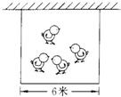

# Mathematics (Grade 3)

**ID**: 1a37c3e0
**难度**: medium_hard
**题型**: short_answer

## 题目
一个正方形的鸡舍，一面靠墙，三面用篱笆围起来．（如图）
（1）需要准备多长的篱笆？
（2）如果现有篱笆长是12米，能围成边长是几米的正方形鸡舍？

## 解答

**答案**: 18, 4

1. Step1:对于问题（1），已知正方形鸡舍一面靠墙，篱笆围三面，边长为6米，求篱笆长度就是求三条边长度之和，即6×3
2. Step2:计算6×3的结果为18米，这就是需要准备的篱笆长度
3. Step3:对于问题（2），已知篱笆长12米，篱笆是正方形三条边的长度之和，所以求边长用12÷3
4. Step4:计算12÷3的结果为4米，即能围成的正方形鸡舍边长为4米

## 知识点

**知识点**:
  - 正方形的周长．

---
