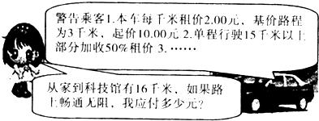

# Mathematics (Grade 3)

**ID**: 1ad28638
**难度**: medium_hard
**题型**: short_answer

## 题目
解决问题：

## 解答

**答案**: 27

1. Step1:确定起价为10元
2. Step2:计算3千米至15千米的距离为15 - 3 = 12千米
3. Step3:计算3千米至15千米的花费为12×2 = 24元
4. Step4:计算15千米至16千米的距离为16 - 15 = 1千米
5. Step5:计算15千米以上每千米的价格为2×(1 + 50%) = 3元
6. Step6:计算15千米至16千米的花费为1×3 = 3元
7. Step7:计算总花费为10 + 24 + 3 = 27元

## 知识点

**知识点**:
  - 整数、小数复合应用题

---
