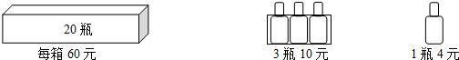

# Mathematics (Grade 3)

**ID**: 1b942a33
**难度**: medium_hard
**题型**: short_answer

## 题目
下面是同一种盒装饮料的价钱．妈妈要买28瓶饮料，最省钱的买法一共要多少元？

## 解答

**答案**: 88

1. Step1:分析已知条件，有每箱20瓶60元、3瓶10元、1瓶4元三种购买方式，目标是买28瓶饮料求最省钱买法的花费
2. Step2:考虑购买组合，先买1箱20瓶，此时还需买28 - 20 = 8瓶
3. Step3:对于剩下的8瓶，选择买2个3瓶（2×3 = 6瓶），此时还需买8 - 6 = 2瓶
4. Step4:最后买2个1瓶正好满足28瓶的需求
5. Step5:计算花费，1箱的花费为60×1 = 60元，2个3瓶的花费为2×10 = 20元，2个1瓶的花费为2×4 = 8元
6. Step6:总花费为60 + 20 + 8 = 88元

## 知识点

**知识点**:
  - 最优化问题

---
