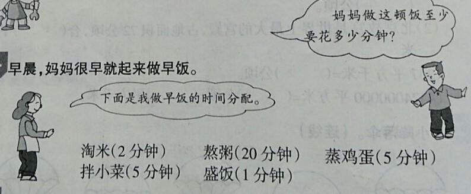

# Mathematics (Grade 3)

**ID**: 1c05cb4c
**难度**: medium_hard
**题型**: short_answer

## 题目
早晨，妈妈很早就起来做早饭

 下面是我做早饭的时间分配
 淘米（2分钟）   熬粥（20分钟）   蒸鸡蛋（5分钟）
 拌小菜（5分钟）   盛饭（1分钟）
 妈妈做这顿饭至少要花多少分钟？

## 解答

**答案**: 23

1. Step1:明确做早饭的基本流程，淘米是熬粥的前置步骤，必须先进行，淘米需要2分钟
2. Step2:熬粥需要20分钟，在这20分钟内可以同时进行蒸鸡蛋（5分钟）和拌小菜（5分钟），因为蒸鸡蛋和拌小菜的总时长5 + 5 = 10分钟小于熬粥的20分钟，所以可以在熬粥时完成这两项，不额外增加总时长
3. Step3:熬粥完成后需要盛饭，盛饭需要1分钟
4. Step4:计算做这顿饭至少花费的时间，将淘米、熬粥、盛饭的时间相加，即2 + 20 + 1 = 23分钟

## 知识点

**知识点**:
  - --

---
