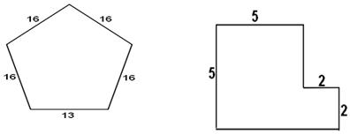

# Mathematics (Grade 3)

**ID**: 1c8bbba4
**难度**: medium_hard
**题型**: short_answer

## 题目
求出如图各图形的周长．（单位：厘米）

## 解答

**答案**: 77, 24

1. Step1:对于第一个图形，其周长是围成它的五条线段长度之和，五条边分别为4条长度为16厘米的边和1条长度为13厘米的边，所以周长计算为16×4 + 13，先计算乘法16×4 = 64，再计算加法64 + 13 = 77厘米
2. Step2:对于第二个图形，可通过平移线段将其转化为一个长方形，长方形的长为5 + 2 = 7厘米，宽为5厘米，根据长方形周长公式（长 + 宽）×2，可得周长为（5 + 2 + 5）×2，先计算括号内5 + 2 + 5 = 12，再计算乘法12×2 = 24厘米

## 知识点

**知识点**:
  - 长方形的周长

---
