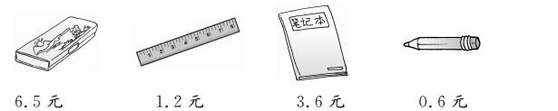

# Mathematics (Grade 3)

**ID**: 1d44bb87
**难度**: medium_hard
**题型**: short_answer

## 题目
买文具。

（1）买一个文具盒和一把尺子共花多少元？
（2）你还能提出其他数学问题并解答吗？

## 解答

**答案**: 7.7, 4.2

1. Step1:根据题目，求买一个文具盒和一把尺子共花多少元，已知文具盒价格是6.5元，尺子价格是1.2元，将两者价格相加，即6.5 + 1.2 = 7.7元
2. Step2:提出问题“买一本笔记本和一支笔共花多少元？”，已知笔记本价格是3.6元，笔的价格是0.6元，将两者价格相加，即3.6 + 0.6 = 4.2元

## 知识点

**知识点**:
  - 一位小数的加法和减法

---
