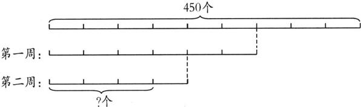

# Mathematics (Grade 3)

**ID**: 24370250
**难度**: medium_hard
**题型**: short_answer

## 题目
迎“六一”儿童节，工艺品厂计划制作450个洋娃娃，完成情况如下：

## 解答

**答案**: 150

1. Step1:根据线段图可知450个洋娃娃被平均分成9等份
2. Step2:计算每份的数量，用总数450除以份数9，即450÷9 = 50个
3. Step3:由图可知第二周完成的是其中3份
4. Step4:计算第二周完成的数量，用每份的数量50乘以份数3，即50×3 = 150个

## 知识点

**知识点**:
  - 图文应用题；分数四则复合应用题．

---
