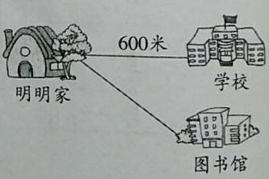

# Mathematics (Grade 3)

**ID**: 249fb30b
**难度**: medium_hard
**题型**: short_answer

## 题目
明明步行的速度是60米/分，照这样算：
 ①他从家走到图书馆用了14分钟，明明家到图书馆的路程是多少米？
 ②明明放学回家最少要走多少分钟？

 明明家        600米   学校     图书馆

## 解答

**答案**: 840, 10

1. Step1:根据路程=速度×时间，明明步行速度是60米/分，从家走到图书馆用了14分钟，所以明明家到图书馆的路程为60×14=840米
2. Step2:已知明明家到学校距离为600米，速度为60米/分，根据时间=路程÷速度，明明放学回家最少要走的时间为600÷60=10分钟

## 知识点

**知识点**:
  - --

---
