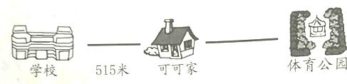

# Mathematics (Grade 3)

**ID**: 25007730
**难度**: medium_hard
**题型**: short_answer

## 题目

可可从家到学校步行大约需要5分钟，以同样的速度，他从家到体育公园步行大约需要9分钟，
（1）可可每分钟大约步行多少米？
（2）可可家离体育公园的距离大约是多少米？

## 解答

**答案**: 103, 927

1. Step1:根据已知，从家到学校的路程是515米，时间是5分钟，由速度=路程÷时间，可得可可步行速度为515÷5=103米/分钟，从而得出可可每分钟大约步行103米
2. Step2:已知可可步行速度为103米/分钟，从家到体育公园步行大约需要9分钟，根据路程=速度×时间，可得可可家到体育公园的距离为103×9=927米

## 知识点

**知识点**:
  - 简单的行程问题

---
