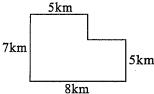

# Mathematics (Grade 3)

**ID**: 325c0811
**难度**: medium_hard
**题型**: short_answer

## 题目
计算如图的面积和周长．

## 解答

**答案**: 30, 50

1. Step1:将图形的周长通过平移转化为长8千米、宽7千米的长方形的周长，根据长方形周长公式c=(a+b)×2，其中a=8，b=7，可得(8+7)×2=15×2=30（千米）
2. Step2:将图形分割为两个长方形，一个长8千米、宽5千米，另一个长5千米、宽(7 - 5)千米，根据长方形面积公式s=ab，可得8×5+5×(7 - 5)=40+10=50（平方千米）

## 知识点

**知识点**:
  - 长方形的周长；长方形、正方形的面积．

---
