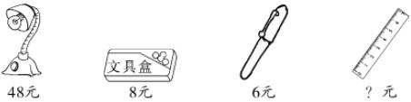

# Mathematics (Grade 3)

**ID**: 34f8a7d0
**难度**: medium_hard
**题型**: short_answer

## 题目
购物。

（1）买一盏台灯的钱可以买几个钢笔？
（2）买7个文具盒多少钱？
（3）用买一个钢笔的钱可以买3把尺子，一把尺子多少钱？

## 解答

**答案**: 8, 56, 2

1. Step1:根据题意，求买一盏台灯的钱可以买几个钢笔，已知台灯48元，钢笔6元，因为求48里面含有几个6用除法计算，所以48÷6=8个
2. Step2:求买7个文具盒多少钱，已知一个文具盒8元，因为求7个8是多少用乘法计算，所以8×7=56元
3. Step3:已知用买一个钢笔的钱可以买3把尺子，钢笔6元，依据总价÷数量=单价，所以6÷3=2元

## 知识点

**知识点**:
  - 整数乘法应用题;整数除法应用题

---
