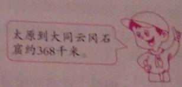

# Mathematics (Grade 3)

**ID**: 3d2d517a
**难度**: medium_hard
**题型**: short_answer

## 题目
旅游团租旅游车从太原到大同云冈石窟参观.
 （1）旅游车每小时约行92千米，该旅游团大约需几小时达到？

 太原到大同云冈石窟大约368千米
 （2）若租车费用每小时为240元，该旅游团往返需付租车费多少元？

## 解答

**答案**: 4, 1920

1. Step1:根据公式时间=路程÷速度，已知路程为368千米，速度为每小时92千米，所以计算368÷92得到旅游团从太原到大同云冈石窟所需时间为4小时
2. Step2:已知租车费用每小时240元，从太原到大同云冈石窟所需时间为4小时，往返则需乘以2，所以计算240×4×2得到该旅游团往返需付租车费1920元

## 知识点

**知识点**:
  - 

---
