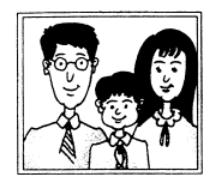

# Mathematics (Grade 3)

**ID**: 4039a186
**难度**: medium_hard
**题型**: short_answer

## 题目
豆豆生日那天，爸爸、妈妈带豆豆去照相馆照全家福留念。照相时，他们三人排成一排，有多少种不同的排法？

## 解答

**答案**: 6

1. Step1:给爸爸、妈妈、豆豆分别编号为甲、乙、丙
2. Step2:分析甲在最左边的情况，此时乙在中间丙在右边或者乙在右边丙在中间，有2种排法
3. Step3:分析乙在最左边的情况，此时甲在中间丙在右边或者甲在右边丙在中间，有2种排法
4. Step4:分析丙在最左边的情况，此时甲在中间乙在右边或者甲在右边乙在中间，有2种排法
5. Step5:将所有排法数量相加，2 + 2 + 2 = 6种

## 知识点

**知识点**:
  - 加法原理（分类枚举）(奥数)

---
