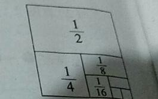

# Mathematics (Grade 3)

**ID**: 4096f1eb
**难度**: medium_hard
**题型**: short_answer

## 题目
下图代表“1”，请根据图形结构，巧妙算出
 $\frac{1}{2}+\frac{1}{4}+\frac{1}{8}+...+\frac{1}{64}$
  的和是多少？

$\frac{1}{2}$
$\frac{1}{4}$
$\frac{1}{8}$
$\frac{1}{16}$

## 解答

**答案**: $\frac{63}{64}$

1. Step1:观察图形和算式，发现规律为从$\frac{1}{2}$开始依次相加的和等于1减去最后一个加数
2. Step2:算式$\frac{1}{2}+\frac{1}{4}+\frac{1}{8}+...+\frac{1}{64}$中最后一个加数是$\frac{1}{64}$
3. Step3:根据规律可得$\frac{1}{2}+\frac{1}{4}+\frac{1}{8}+...+\frac{1}{64}=1 - \frac{1}{64}$
4. Step4:计算$1 - \frac{1}{64}=\frac{64}{64}-\frac{1}{64}=\frac{63}{64}$
## 知识点

**知识点**:
  - --

---
