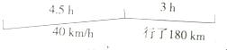

# Mathematics (Grade 3)

**ID**: 439a70e5
**难度**: medium_hard
**题型**: short_answer

## 题目
如图，汽车每小时行多少千米？

## 解答

**答案**: 48

1. Step1:根据速度×时间=路程，计算汽车4.5小时行驶的路程，即40×4.5 = 180千米
2. Step2:计算汽车总共行驶的路程，4.5小时行驶的180千米加上后面行驶的180千米，180 + 180 = 360千米
3. Step3:计算汽车行驶的总时间，4.5小时加上3小时，4.5 + 3 = 7.5小时
4. Step4:根据路程÷时间=速度，用总路程360千米除以总时间7.5小时，360÷7.5 = 48千米

## 知识点

**知识点**:
  - 简单的行程问题

---
