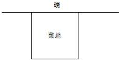

# Mathematics (Grade 3)

**ID**: 44b7ec77
**难度**: medium_hard
**题型**: short_answer

## 题目
一块正方形菜地，一边靠墙，其余三边围上总长度为24米的竹篱笆．这块正方形菜地的面积是多少平方米？

## 解答

**答案**: 64

1. Step1:因为正方形菜地一边靠墙，三边竹篱笆总长度为24米，所以用24除以3，得到正方形菜地的边长为24÷3 = 8米
2. Step2:根据正方形面积公式S = a×a（其中a为边长），将边长8米代入公式，可得面积为8×8 = 64平方米

## 知识点

**知识点**:
  - 长方形、正方形的面积．

---
