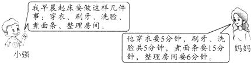

# Mathematics (Grade 3)

**ID**: 4c152a9a
**难度**: medium_hard
**题型**: short_answer

## 题目
小强应该如何安排？小强做完这些事情至少需要多少分钟？

## 解答

**答案**: 穿衣→煮面条（同时可以刷牙、洗脸，整理房间）, 20

1. Step1:明确要完成的事情有穿衣、刷牙洗脸、煮面条、整理房间
2. Step2:分析各事情所需时间，穿衣5分钟，刷牙洗脸共5分钟，煮面条15分钟，整理房间6分钟
3. Step3:考虑事情之间的先后顺序和能否同时进行，穿衣必须先进行，煮面条时间较长，刷牙洗脸和整理房间总时长5 + 6 = 11分钟小于煮面条的15分钟，所以可以在煮面条时同时进行刷牙洗脸和整理房间
4. Step4:得出安排方法为穿衣→煮面条（同时可以刷牙、洗脸，整理房间）
5. Step5:计算做完这些事情至少需要的时间，穿衣5分钟加上煮面条15分钟，即5 + 15 = 20分钟

## 知识点

**知识点**:
  - 沏茶问题．

---
