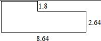

# Mathematics (Grade 3)

**ID**: 4cb52772
**难度**: medium_hard
**题型**: short_answer

## 题目
求图的周长（单位：厘米）

## 解答

**答案**: 26.16

1. Step1:根据解析2可知，将图形周长转化为长方形周长，长方形的长为8.64厘米，宽为1.8 + 2.64 = 4.44厘米
2. Step2:根据长方形周长公式（长 + 宽）×2，计算该长方形周长，即(8.64 + 4.44)×2
3. Step3:先计算括号内的值8.64 + 4.44 = 13.08
4. Step4:再计算13.08×2 = 26.16厘米，得到图形的周长

## 知识点

**知识点**:
  - 长方形的周长

---
