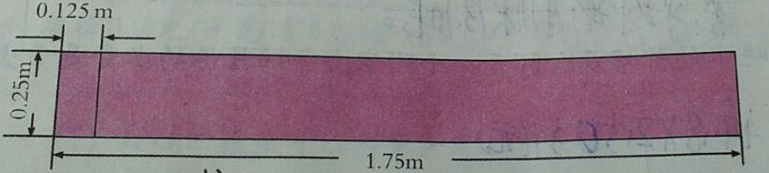

# Mathematics (Grade 3)

**ID**: 503b7928
**难度**: medium_hard
**题型**: short_answer

## 题目
乐乐买了一张长1.75m、宽0.25m的彩色纸，准备把它裁成宽0.125m的贺卡衬底(如图所示)，这张彩色纸可以裁成多少张这样的衬底？

 0.25m  0.125m  1.75m

## 解答

**答案**: 14

1. Step1:明确题目要求是求彩色纸能裁成多少张衬底
2. Step2:分析得出裁成的张数取决于彩色纸的长里有多少个衬底的宽
3. Step3:确定用除法计算，即彩色纸的长除以衬底的宽，算式为1.75÷0.125
4. Step4:计算1.75÷0.125的结果为14
5. Step5:得出这张彩色纸可以裁成14张这样的衬底

## 知识点

**知识点**:
  - --

---
