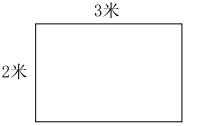

# Mathematics (Grade 3)

**ID**: 52fc97bd
**难度**: medium_hard
**题型**: short_answer

## 题目
过年了，爸爸买了一个大壁镜（如图），准备在壁镜的周围绕上小彩灯。
（1）至少要买多少米的小彩灯？
（2）如果每米小彩灯3元钱，一共要花多少钱？

## 解答

**答案**: 10, 30

1. Step1:根据长方形周长公式(长+宽)×2，已知长为3米，宽为2米，可得(2 + 3)×2 = 5×2 = 10米，此为至少要买的小彩灯长度
2. Step2:已知每米小彩灯3元钱，要买10米，用每米价钱×米数，即3×10 = 30元，此为一共要花的钱数

## 知识点

**知识点**:
  - 长方形与正方形的周长

---
