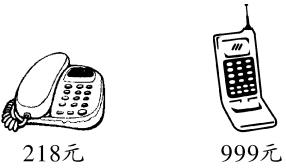

# Mathematics (Grade 3)

**ID**: 558d6041
**难度**: medium_hard
**题型**: short_answer

## 题目

李老师想买这两样商品，需花费多少钱？

## 解答

**答案**: 1217

1. Step1:明确题目需求是求买两样商品的总花费
2. Step2:从图中获取两样商品价格分别为218元和999元
3. Step3:根据加法意义，确定用218 + 999来计算总花费
4. Step4:依据整数加法计算法则计算218 + 999的结果为1217

## 知识点

**知识点**:
  - 进位加法

---
