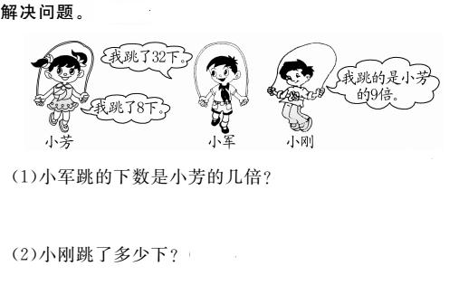

# Mathematics (Grade 3)

**ID**: 55a689af
**难度**: medium_hard
**题型**: short_answer

## 题目

解决问题。
小芳：我跳了32下。 
小军：我跳了8下。
小刚：我跳的是小芳的9倍。
（1）小军跳的下数是小芳的几倍？
（2）小刚跳了多少下？

## 解答

**答案**: 4, 72

1. Step1:求小军跳的下数是小芳的几倍，根据求一个数是另一个数的几倍用除法计算，用小军跳的8下除以小芳跳的32下，即8÷32，得出结果为4
2. Step2:求小刚跳了多少下，根据求一个数的几倍是多少用乘法计算，用小芳跳的32下乘以9倍，即32×9，得出结果为72

## 知识点

**知识点**:
  - 表内乘法;表内除法

---
