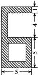

# Mathematics (Grade 3)

**ID**: 588ae97a
**难度**: medium_hard
**题型**: short_answer

## 题目
长方形的院子里有一条“6”字形的小路，路宽1米，具体情况如图，现要在小路上铺满砖，其余地方种草，那么砖地的周长是多少米？

## 解答

**答案**: 50

1. Step1:计算长为5 + 4 + 1 = 10米
2. Step2:计算5 - 1×2 = 3米
3. Step3:计算5 - 1 = 4米
4. Step4:计算长10米宽5米的长方形周长为(10 + 5)×2
5. Step5:计算边长为3米的正方形的周长为3×4
6. Step6:计算两条长4米的线段的长度和为4×2
7. Step7:将上述结果相加得到(10 + 5)×2 + 3×4 + 4×2 = 30 + 12 + 8 = 50米

## 知识点

**知识点**:
  - 巧算周长．

---
