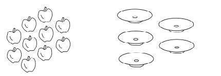

# Mathematics (Grade 3)

**ID**: 5c6979ef
**难度**: medium_hard
**题型**: short_answer

## 题目

（1）10个苹果，平均放在5个盘里，每盘放多少个？
（2）10个苹果，每2个一盘，可以放多少盘？

## 解答

**答案**: 2, 5

1. Step1:分析问题（1），已知有10个苹果要平均放在5个盘里，根据每份的量=总数÷总份数，这里总数是10，总份数是5，所以用10除以5计算，即10÷5=2，得出每盘放2个
2. Step2:分析问题（2），已知有10个苹果，每2个一盘，根据求一个数里面有几个另一个数用除法计算，这里是求10里面有几个2，所以用10除以2计算，即10÷2=5，得出可以放5盘
3. Step3:整理答案，将问题（1）的答案2和问题（2）的答案5组成列表['2', '5']

## 知识点

**知识点**:
  - 整数除法应用题

---
