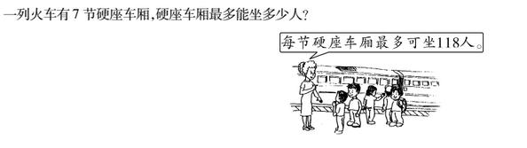

# Mathematics (Grade 3)

**ID**: 5d3adb5a
**难度**: medium_hard
**题型**: short_answer

## 题目

一列火车有7节硬座车厢，硬座车厢最多能坐多少人？
每节硬座车厢最多可坐118人。

## 解答

**答案**: 826

1. Step1:明确题目所求为7节硬座车厢最多能坐的总人数
2. Step2:已知每节车厢最多坐118人，即每份数是118，车厢节数7为份数
3. Step3:根据每份数×份数=总数的关系，列出乘法算式118×7
4. Step4:计算118×7的结果为826，得到硬座车厢最多能坐的人数

## 知识点

**知识点**:
  - 整数乘法应用题

---
