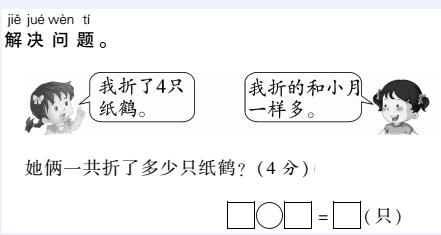

# Mathematics (Grade 3)

**ID**: 5da66bf8
**难度**: medium_hard
**题型**: short_answer

## 题目

解决问题。（jiě jué wèn tí）
我折了4只纸鹤。
我折的和小月一样多。
她们一共折了多少只纸鹤？
□○□=□（只）

## 解答

**答案**: 8

1. Step1:明确小月折了4只纸鹤
2. Step2:因为另一个人折的和小月一样多，所以另一个人也折了4只纸鹤
3. Step3:根据加法的意义，求两人一共折的纸鹤数，用两人折的纸鹤数相加，即4 + 4
4. Step4:计算4 + 4的结果为8

## 知识点

**知识点**:
  - 整数的加法和减法

---
