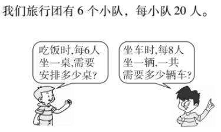

# Mathematics (Grade 3)

**ID**: 60886a0b
**难度**: medium_hard
**题型**: short_answer

## 题目

我们旅行团有6个小队，每小队20人。
吃饭时，每6人坐一桌，需要安排多少桌？
坐车时，每8人坐一辆，一共需要多少辆车？

## 解答

**答案**: 20, 15

1. Step1:先计算旅行团总人数，根据每小队20人，共6个小队，用乘法可得20×6 = 120人
2. Step2:计算吃饭时需要的桌数，已知总人数120人，每6人坐一桌，用除法可得120÷6 = 20桌
3. Step3:计算坐车时需要的车辆数，已知总人数120人，每8人坐一辆车，用除法可得120÷8 = 15辆

## 知识点

**知识点**:
  - 整数乘法应用题;整数除法应用题

---
