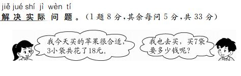

# Mathematics (Grade 3)

**ID**: 615fdacb
**难度**: medium_hard
**题型**: short_answer

## 题目

解决实际问题。（jiě jué shí jì wèn tí）。
我今天买的苹果很合适，3小袋共花了18元。
我也去买，买了7袋要多少钱呢？

## 解答

**答案**: 42

1. Step1:根据‘3小袋共花了18元’，用除法计算1小袋苹果的价格，即18÷3 = 6（元）
2. Step2:用1小袋苹果的价格乘以7，得到买7袋苹果需要的钱数，即6×7 = 42（元）

## 知识点

**知识点**:
  - 表内乘法;表内除法

---
