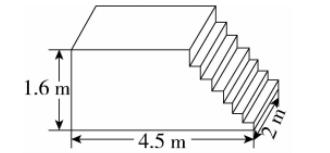

# Mathematics (Grade 3)

**ID**: 627d1647
**难度**: medium_hard
**题型**: short_answer

## 题目
要在下图楼梯及上面铺地毯，地毯的总面积至少是多少平方米？

## 解答

**答案**: 12.2

1. Step1:明确地毯铺的位置，其长是楼梯水平长4.5米与垂直高1.6米的和
2. Step2:计算地毯的长，4.5 + 1.6 = 6.1米
3. Step3:已知地毯宽为2米
4. Step4:根据长方形面积公式，面积 = 长×宽，计算地毯面积为6.1×2 = 12.2平方米

## 知识点

**知识点**:
  - 长方形与正方形的面积;小数四则混合运算

---
