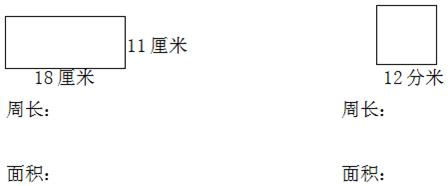

# Mathematics (Grade 3)

**ID**: 67c31725
**难度**: medium_hard
**题型**: short_answer

## 题目
求下列图形的周长和面积．

## 解答

**答案**: 58, 198, 48, 144

1. Step1:根据长方形周长公式，计算长方形周长，即(18 + 11)×2 = 58厘米
2. Step2:根据长方形面积公式，计算长方形面积，即18×11 = 198平方厘米
3. Step3:根据正方形周长公式，计算正方形周长，即12×4 = 48分米
4. Step4:根据正方形面积公式，计算正方形面积，即12×12 = 144平方分米

## 知识点

**知识点**:
  - 长方形、正方形的面积;长方形的周长;正方形的周长

---
