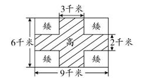

# Mathematics (Grade 3)

**ID**: 684e6d87
**难度**: medium_hard
**题型**: short_answer

## 题目
有一个长9千米，宽6千米的长方形林场。 为了利于树木成长，林场在四个角种植矮植株植物，中间种植高植株植物，如图所示。求该林场中间种植的高植株植物的面积。

## 解答

**答案**: 30

1. Step1:根据长方形面积公式，计算长方形林场的总面积，长方形林场长9千米，宽6千米，所以总面积为9×6 = 54平方千米
2. Step2:把四个角种植矮植株植物的面积看成一个长方形的面积，其长为9 - 3 = 6千米，宽为6 - 2 = 4千米，所以该长方形面积为6×4 = 24平方千米
3. Step3:根据长方形林场的总面积-种植矮植株植物面积=种植高植株植物的面积，可得种植高植株植物的面积为54 - 24 = 30平方千米

## 知识点

**知识点**:
  - 长方形与正方形的面积

---
